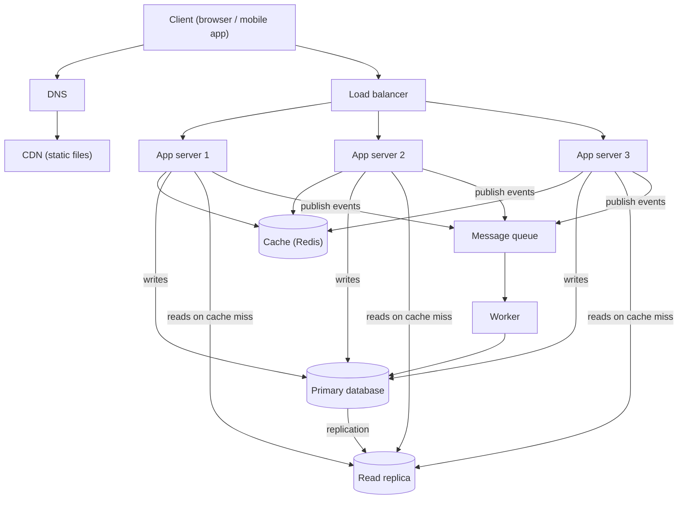

# QuickNotes Architecture

Goal: move QuickNotes from a browser-only app to an online service for **1 million users**.

## 1. Requirements

### Functional (what the system does)

- Users can sign up and log in.
- Users can create, read, update and delete their own notes.
- Users can tag notes and filter by tag.
- Notes are available on every device the user logs in from.

### Non-functional (how well it does it)

- **Availability:** 99.9% uptime (about 9 hours of downtime per year at most).
- **Latency:** listing notes responds in under 200 ms for 95% of requests.
- **Scalability:** handle 1 million users, and grow by adding servers, not by rewriting.
- **Durability:** a saved note is never lost (backups plus a replica).
- **Security:** HTTPS everywhere, hashed passwords, users can only access their own notes.
- **Consistency:** a user sees their own new note immediately; other devices may lag by a second or two.

## 2. Load estimate (1 million users)

These are **assumptions**; real numbers will replace them after launch.

| Assumption | Value |
|------------|-------|
| Registered users | 1,000,000 |
| Daily active users (DAU) | 20% = 200,000 |
| Note list views per active user per day | 20 |
| Notes created per active user per day | 5 |
| Average stored note size (title, body, tags, row overhead) | ~1 KB |
| Peak traffic is about 10 times the average | ×10 |

**Reads per second**

- 200,000 × 20 = 4,000,000 reads/day
- 4,000,000 ÷ 86,400 seconds ≈ **46 reads/s on average**, so about **460 reads/s at peak**

**Writes per second**

- 200,000 × 5 = 1,000,000 writes/day
- 1,000,000 ÷ 86,400 ≈ **12 writes/s on average**, so about **120 writes/s at peak**

**Storage per year**

- 1,000,000 notes/day × 365 = 365,000,000 notes/year
- 365,000,000 × 1 KB ≈ **365 GB per year** of raw data (about 0.5 to 0.7 TB with indexes)

These numbers are small enough for one primary database. The design below adds redundancy for safety and headroom, not because one machine could not cope with the raw speed.

## 3. Architecture diagram



Plain-text version of the same picture:

```
Client -> DNS -> CDN (static files: HTML, CSS, JS)
Client -> Load balancer -> App server 1 / 2 / 3
App servers -> Cache (Redis)
App servers -> Primary DB (writes)  ==replication==>  Read replica (reads)
App servers -> Queue -> Worker -> Primary DB
```

## 4. Why each component exists

- **Client:** the browser or phone app where the user sees and edits notes.
- **DNS:** turns the name `quicknotes.example` into the IP address of our entry point, so we can move servers without users noticing.
- **CDN:** serves static files (HTML, CSS, JavaScript, images) from a location near the user, which makes pages load faster and keeps that traffic off our servers.
- **Load balancer:** spreads incoming requests across the app servers and stops sending traffic to a server that is unhealthy.
- **App servers (3):** run the API code; being stateless, we can add more when traffic grows, and if one dies the others carry on.
- **Cache (Redis):** keeps recently read note lists in memory so most reads never touch the database, which keeps responses fast and the database calm.
- **Primary database:** the single source of truth where all writes go, so data stays consistent.
- **Read replica:** a live copy of the primary that answers read queries, which spreads the load and can take over if the primary fails.
- **Queue:** holds slow background jobs (search indexing, emails, cleanup) so the user does not wait for them.
- **Worker:** takes jobs from the queue and does them in the background at its own pace.

## 5. Request flows

### GET /notes (read)

1. The client sends `GET /notes` with its token over HTTPS.
2. DNS has already resolved the hostname to the load balancer.
3. The load balancer picks a healthy app server.
4. The app server checks the token. If it is invalid, it returns `401`.
5. The app server looks in the cache for the key `notes:user:7:page1`.
6. **Cache hit:** it returns the cached JSON immediately (steps 7 to 8 are skipped).
7. **Cache miss:** it runs the "newest 10 notes" query on the **read replica**.
8. It stores the result in the cache with a 60 second expiry.
9. The app server returns `200 OK` with the JSON list.

### POST /notes (write)

1. The client sends `POST /notes` with the JSON body and its token.
2. The load balancer forwards it to a healthy app server.
3. The app server checks the token (`401` if invalid) and validates the body (`400` if the title is missing or over 100 characters).
4. The app server inserts the note into the **primary database**. If this fails, it returns `500`.
5. The app server deletes the user's cached lists (`notes:user:7:*`), so the next read is fresh.
6. The app server publishes a `note.created` event to the **queue**.
7. The app server returns `201 Created` with the new note. The user is done; they do not wait for the next step.
8. Later, a **worker** takes the event from the queue and does the slow extras (update the search index, send a sync notification to the user's other devices). If it fails, the job is retried.

## 6. Trade-offs

1. **Cache speed vs. freshness.** The cache makes reads very fast, but cached data can be slightly out of date. We delete the user's cache on every write, and use a 60 second expiry as a safety net. We accept a tiny staleness risk for much lower latency.
2. **Read replica lag (consistency vs. scale).** The replica copies the primary with a delay of milliseconds to a second. A read straight after a write could miss the new note. To fix that, the app reads from the primary for a few seconds after that user writes, and uses the replica the rest of the time.
3. **Queue = faster responses, but more complexity.** Background work makes `POST` fast, but now the system has an extra part to run, jobs can arrive twice (workers must be safe to repeat), and results appear slightly later.
4. **SQL vs. sharding.** One primary is simple and consistent, but writes cannot scale beyond one machine. At our estimated 120 writes/s this is fine. If we grow 50 times larger we would shard by `user_id`.

## 7. Avoiding single points of failure

A single point of failure (SPOF) is one part whose failure takes the whole system down. Every component has a backup:

| Component | How the SPOF is avoided |
|-----------|-------------------------|
| DNS | Managed DNS service that already runs on many servers worldwide |
| CDN | Managed CDN with many edge locations; if it fails, the browser can fall back to the origin |
| Load balancer | A pair of load balancers (active and standby) or a managed cloud load balancer spread over several zones |
| App servers | Three or more identical stateless servers in different availability zones; health checks remove a failed one |
| Cache | Redis with a replica and automatic failover. If the whole cache is lost, requests fall back to the database (slower, but still working) |
| Database | Primary plus read replica in a different zone; if the primary fails, the replica is promoted automatically. Nightly backups plus continuous log archiving protect against data loss |
| Queue and worker | A clustered, replicated queue; several workers run at once, and unfinished jobs return to the queue if a worker crashes |
