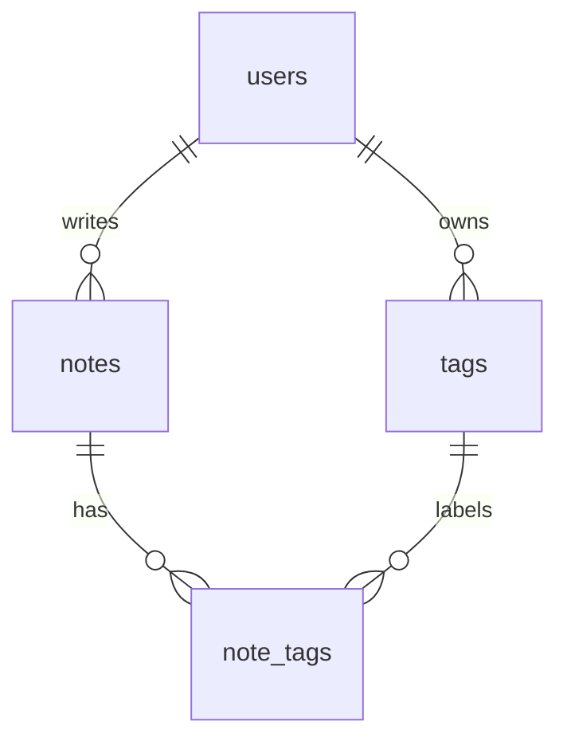

# QuickNotes Data Model

QuickNotes stores four things: people (**users**), what they write (**notes**), labels (**tags**), and the link between notes and labels (**note_tags**).

## 1. Entities

PK = primary key (uniquely identifies a row). FK = foreign key (points to a row in another table).

### users

| Column | Type | Key / constraint |
|--------|------|------------------|
| `id` | BIGINT (auto-generated) | **PK** |
| `email` | VARCHAR(255) | NOT NULL, UNIQUE |
| `password_hash` | VARCHAR(255) | NOT NULL |
| `display_name` | VARCHAR(100) | NOT NULL |
| `created_at` | TIMESTAMPTZ | NOT NULL, default now |

### notes

| Column | Type | Key / constraint |
|--------|------|------------------|
| `id` | BIGINT (auto-generated) | **PK** |
| `user_id` | BIGINT | **FK** → `users.id`, NOT NULL |
| `title` | VARCHAR(100) | NOT NULL |
| `body` | TEXT | optional |
| `created_at` | TIMESTAMPTZ | NOT NULL, default now |
| `updated_at` | TIMESTAMPTZ | NOT NULL, default now |

### tags

| Column | Type | Key / constraint |
|--------|------|------------------|
| `id` | BIGINT (auto-generated) | **PK** |
| `user_id` | BIGINT | **FK** → `users.id`, NOT NULL |
| `name` | VARCHAR(50) | NOT NULL, UNIQUE together with `user_id` |

### note_tags (join table)

| Column | Type | Key / constraint |
|--------|------|------------------|
| `note_id` | BIGINT | **FK** → `notes.id`, part of the composite **PK** |
| `tag_id` | BIGINT | **FK** → `tags.id`, part of the composite **PK** |

## 2. Relationships

- **One-to-many: users → notes.** One user writes many notes, but each note has exactly one author. The "many" side (`notes`) holds the foreign key `user_id`.
- **One-to-many: users → tags.** Each user owns their own set of tags (`tags.user_id`).
- **Many-to-many: notes ↔ tags.** One note can have many tags ("work" and "urgent"), and one tag can be on many notes. A relational database cannot store that in two columns, so we add the join table `note_tags`. Each row says "this note has this tag". Its composite primary key `(note_id, tag_id)` stops the same tag being attached to the same note twice.



## 3. CREATE TABLE statements (PostgreSQL)

```sql
CREATE TABLE users (
    id            BIGINT GENERATED ALWAYS AS IDENTITY PRIMARY KEY,
    email         VARCHAR(255) NOT NULL UNIQUE,
    password_hash VARCHAR(255) NOT NULL,
    display_name  VARCHAR(100) NOT NULL,
    created_at    TIMESTAMPTZ  NOT NULL DEFAULT now()
);

CREATE TABLE notes (
    id         BIGINT GENERATED ALWAYS AS IDENTITY PRIMARY KEY,
    user_id    BIGINT       NOT NULL REFERENCES users(id) ON DELETE CASCADE,
    title      VARCHAR(100) NOT NULL,
    body       TEXT,
    created_at TIMESTAMPTZ  NOT NULL DEFAULT now(),
    updated_at TIMESTAMPTZ  NOT NULL DEFAULT now()
);

CREATE TABLE tags (
    id      BIGINT GENERATED ALWAYS AS IDENTITY PRIMARY KEY,
    user_id BIGINT      NOT NULL REFERENCES users(id) ON DELETE CASCADE,
    name    VARCHAR(50) NOT NULL,
    UNIQUE (user_id, name)
);

CREATE TABLE note_tags (
    note_id BIGINT NOT NULL REFERENCES notes(id) ON DELETE CASCADE,
    tag_id  BIGINT NOT NULL REFERENCES tags(id)  ON DELETE CASCADE,
    PRIMARY KEY (note_id, tag_id)
);
```

`ON DELETE CASCADE` means deleting a note automatically deletes its `note_tags` rows, so no orphan rows are left behind.

## 4. Example queries

**a) The 10 newest notes of user 7** (what `GET /notes` runs):

```sql
SELECT id, title, body, created_at
FROM notes
WHERE user_id = 7
ORDER BY created_at DESC
LIMIT 10;
```

**b) Notes with their tags (uses JOINs):**

```sql
SELECT n.id, n.title, t.name AS tag
FROM notes n
JOIN note_tags nt ON nt.note_id = n.id
JOIN tags t       ON t.id = nt.tag_id
WHERE n.user_id = 7
ORDER BY n.created_at DESC;
```

**c) How many notes does each tag have?**

```sql
SELECT t.name, COUNT(*) AS note_count
FROM tags t
JOIN note_tags nt ON nt.tag_id = t.id
WHERE t.user_id = 7
GROUP BY t.name
ORDER BY note_count DESC;
```

**d) Create a note** (what `POST /notes` runs):

```sql
INSERT INTO notes (user_id, title, body)
VALUES (7, 'Buy milk', 'Two litres, semi-skimmed')
RETURNING id, created_at;
```

## 5. Indexes

```sql
CREATE INDEX idx_notes_user_created ON notes (user_id, created_at DESC);
CREATE INDEX idx_note_tags_tag      ON note_tags (tag_id);
```

**Why `idx_notes_user_created`?** Almost every request is "show me *my* newest notes" (query a). Without an index the database reads every row of a table that will hold hundreds of millions of notes. With this index it jumps straight to the user's rows, already sorted newest first. The cost is slightly slower inserts and a little extra disk space, which is a good trade for a read-heavy app.

**Why `idx_note_tags_tag`?** The composite primary key already speeds up "tags of a note". This second index speeds up the reverse question, "notes with this tag" (the `?tag=` filter).

## 6. SQL or NoSQL?

I choose **SQL (PostgreSQL)**. The data is naturally relational (users own notes, notes have tags), and the many-to-many tag relationship with joins is exactly what SQL does best. Foreign keys and transactions guarantee consistency: a note cannot point to a user that does not exist, and creating a note plus its tags either fully succeeds or fully fails. A note is small (about 1 KB), so a single well-indexed primary with read replicas can serve 1 million users, and later we can shard by `user_id` because users never read each other's notes. A NoSQL document store would be easier to shard on day one, but we would lose joins and constraints that we need now.
